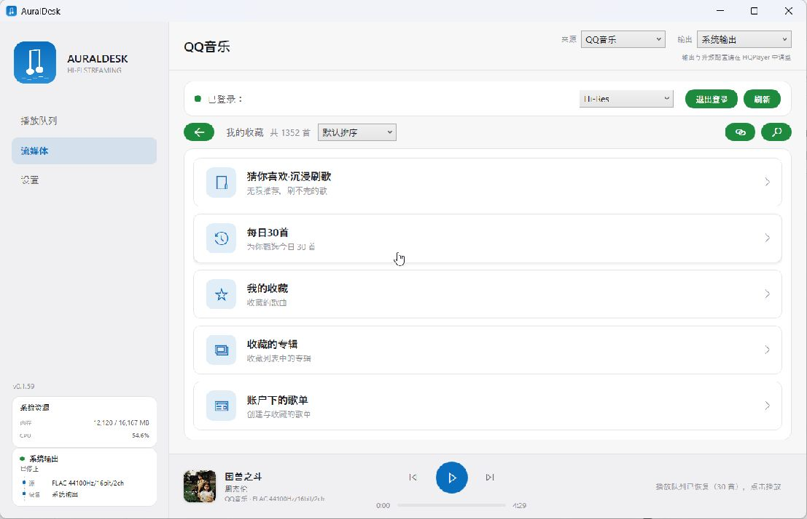
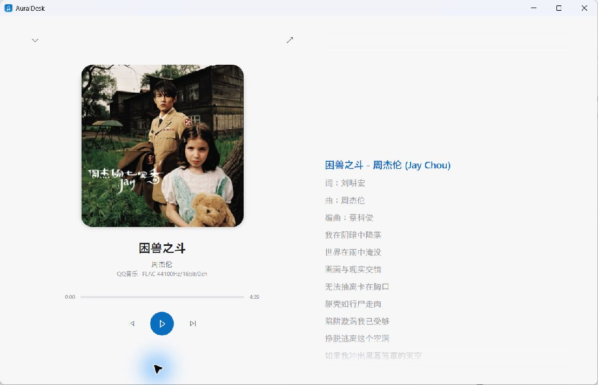
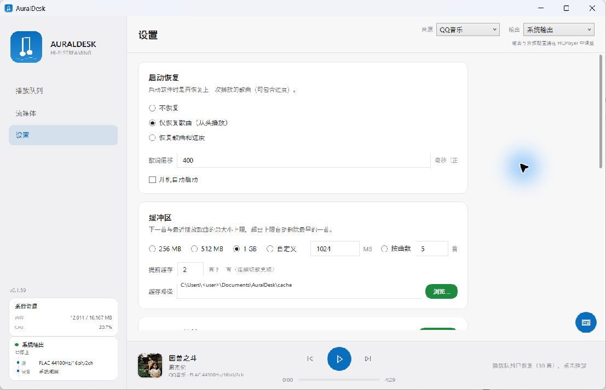

# AuralDesk

English | [中文](README.zh-CN.md)

AuralDesk is a Windows streaming front-end for QQ Music. It downloads and decrypts a track locally, then hands the complete lossless file to HQPlayer for upsampling. Whether the DAC is connected over USB or NAA is left to HQPlayer.



## Status

The app is in day-to-day use here and is basically feature-complete. I don't plan to add more large features; the remaining work is bug fixing and small UI improvements.

This is not a general-purpose music player. It was built around one workflow: QQ Music → local decrypted file → HQPlayer → DAC.

## Why this exists

QQ Music's UPnP output is convenient, but it normally stops at 48 kHz and does not pass Hi-Res through. AuralDesk fetches the original file, decrypts it on the PC, and gives HQPlayer the full sample rate and bit depth.

The app also handles the boring parts: loading a whole playlist into the queue, caching the next tracks, cleaning up old files, fetching lyrics and covers, and keeping the QQ Music listening record in sync.

## Screens

The expanded now-playing view. The lyric column follows the track, and the window can be switched to fullscreen:



Settings are kept simple. Output and upsampling configuration still belongs to HQPlayer:



## What it can do

- Browse the QQ Music home page, favorites, playlists, albums, artists, daily 30, and the endless recommendation feed.
- Search QQ Music, open shared playlist/album/song links, and load a full list into the play queue.
- Three quality choices: Hi-Res, Lossless, and Normal. If the selected tier does not exist, it falls back down the chain instead of picking DTS, spatial audio, or the upsampled "master" marketing tiers.
- Decrypt QMC files locally. The decryptor is also maintained separately at [qmc-decrypt](https://github.com/HowenXu/qmc-decrypt).
- Cache the next and previous tracks, show cache state in the queue, and clean old files according to a size or song-count limit.
- Show synced lyrics, translations, album covers, and a fullscreen lyric view.
- Output through HQPlayer, the system audio device, or foobar2000 with beefweb.
- Control HQPlayer playback and digital volume from the desktop app or the Android remote.
- Report playback to QQ Music using the same start/seek/end flow as the official client, so recommendations and the QQ Music yearly recap stay in sync.

## What it does not do

- It cannot bundle HQPlayer. See below.
- It does not write its own yearly listening report. Playback data goes to QQ Music.
- Apple Music is still an empty folder. NetEase Cloud Music is not planned; the existing foobar2000 route is enough for my use.

## Why HQPlayer is not bundled

HQPlayer is closed-source commercial software from Signalyst. Its engine cannot be redistributed or embedded without an agreement with the author.

HQPlayer Embedded is a Linux product, not a Windows library that can be wrapped in an `.exe`. Changing filters, modulators, or output rates also rebuilds the audio pipeline and interrupts playback. That is how the engine works; an external program cannot make it seamless.

So AuralDesk stays on the player side. It talks to HQPlayer through its control protocol for playback, queue changes, status, and volume.

## Install

1. Download `AuralDesk-Setup-*.exe` from [Releases](https://github.com/HowenXu/AuralDesk/releases).
2. Run the installer. It checks for the .NET 8 Desktop Runtime and opens Microsoft's download page if it is missing.
3. HQPlayer is recommended but not required. Use the system output if you only want to try the app.
4. Install `AuralDesk-Android-*.apk` on a phone connected to the same LAN if you want the remote.

## First run

Open the app, switch to the streaming page, and sign in to QQ Music with the QR code. The credential is stored locally on this PC.

Choose an output at the top right:

- `系统输出` sends audio to the default Windows device. Useful for a quick check.
- `HQPlayer` sends the decrypted file to HQPlayer. Configure NAA, USB, filters, and modulators inside HQPlayer.
- `Foobar2000` uses the beefweb component. foobar2000 owns the actual output; AuralDesk only tells it which file to play.

Then choose a quality in Settings. Hi-Res is selected by default. The actual tier is decided by the downloaded file: 44.1/48 kHz FLAC is Lossless, above 48 kHz is treated as Hi-Res, and MP3 is Normal.

## Daily use

Click a song in a playlist, album, artist page, or search result. AuralDesk loads the current page into the queue and starts from the song you clicked.

The next tracks are cached in the background. Cached items are marked in the queue. The cache folder and limit are configurable; old files are removed when the limit is reached.

The bottom cover opens the now-playing view. In fullscreen, the current lyric stays in the upper-middle area and earlier lines remain scrollable.

If the LAN remote is enabled in Settings, the phone app can control playback, the queue, search, favorites, and HQPlayer volume.

## Notes

- Hi-Res downloads bypass the system proxy for the QQ CDN. If downloads are unexpectedly slow, check whether a proxy client is force-routing those connections.
- If HQPlayer is not reachable, make sure it is running, the control port matches, and the output device is configured inside HQPlayer.
- The foobar2000 path is the least tested output here. My own chain is HQPlayer → NAA.
- The app deliberately keeps no local yearly summary. Listening data is sent to QQ Music.

## Repository layout

```text
AuralDesk/
├── *.cs / *.xaml          Windows desktop app (WPF / .NET 8)
├── qqapi/app/             QQ Music API sidecar and local decryption
├── android/               Android remote (Kotlin)
├── docs/images/           README screenshots
└── installer.iss          Inno Setup script
```

## Third-party and licenses

- [QQMusicApi](https://github.com/L-1124/QQMusicApi) (GPL-3.0) for the QQ Music API wrapper.
- [unlock-music](https://github.com/rong6/unlock-music) as a reference for the QMC algorithms.
- [NAudio](https://github.com/naudio/NAudio) (MIT) for audio output.
- [Microsoft.Web.WebView2](https://www.nuget.org/packages/Microsoft.Web.WebView2) for the embedded web view.
- [qmc-decrypt](https://github.com/HowenXu/qmc-decrypt) (AGPL-3.0) for the standalone QMC decryptor.

The project is licensed under [AGPL-3.0](LICENSE). The code under `qqapi/app/qqmusic_api/` keeps the upstream GPL-3.0 terms.

For learning only. Delete any downloaded content within 24 hours.

## Roadmap

- [x] QQ Music browsing, download, decryption, playback, lyrics, queue, and search
- [x] HQPlayer upsampling over NAA or USB
- [x] Android remote
- [ ] Apple Music
- [ ] NetEase Cloud Music
