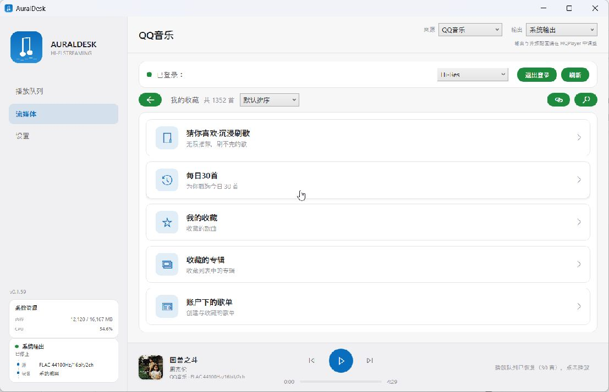
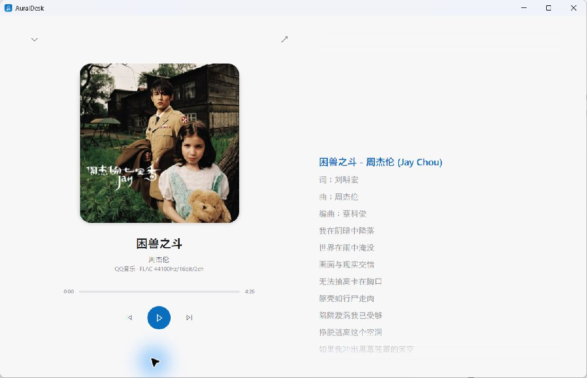
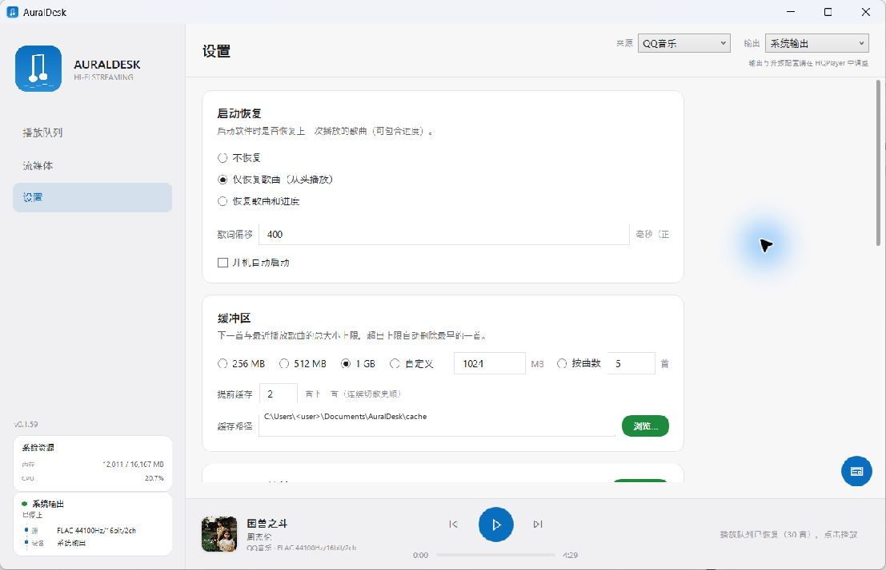

# AuralDesk

[English](README.md) | 中文

AuralDesk 是一个 Windows 上的 QQ 音乐流媒体前端。它把歌曲下载并解密成本地无损文件，再交给 HQPlayer 升频。输出走 USB 还是 NAA，由 HQPlayer 决定。



## 现在是什么状态

软件已经在我这里日常使用，功能基本做完了。后续不打算继续加大的功能，主要就是修 bug 和小幅优化界面。

它不是通用音乐播放器，整套流程只围绕一件事：QQ 音乐 → 本地解密文件 → HQPlayer → 解码器。

## 为什么做这个

QQ 音乐的 UPnP 投送方便，但一般到 48kHz 就结束了，Hi-Res 过不去。AuralDesk 直接取原始文件，在电脑上解密，再把完整的采样率和位深交给 HQPlayer。

播放队列、下一首缓存、旧缓存清理、歌词封面、QQ 音乐听歌记录这些琐事，也一起处理掉。

## 界面

点底部封面会展开正在播放。歌词在右侧跟随播放，也可以切全屏：



设置页只放软件自己的选项，HQPlayer 的输出和升频配置仍在 HQPlayer 里：



## 功能

- 浏览 QQ 音乐主页、我的收藏、歌单、专辑、歌手、每日 30 首和沉浸刷歌。
- 搜索单曲、专辑、歌手，打开分享的歌单/专辑/歌曲链接，把整个列表加载进播放队列。
- 三档音质：Hi-Res、无损、普通。没有对应档位就往下退，不会去选 DTS、空间音频或臻品母带这些升频营销档。
- 本地解密 QMC 文件。解密器单独维护在 [qmc-decrypt](https://github.com/HowenXu/qmc-decrypt)。
- 自动缓存下一首和上一首，播放队列里会标出缓存状态；缓存空间和目录可以自己设。
- 同步歌词、翻译、专辑封面，支持全屏歌词。
- 输出支持 HQPlayer、系统输出、foobar2000（beefweb）。
- 电脑端和手机端都能控制 HQPlayer 的播放和数字音量。
- 按 QQ 客户端的方式上报听歌记录、最近播放和播放时长，推荐和 QQ 音乐年度总结能对上。

## 不做什么

- 不会把 HQPlayer 打包进软件，原因见下。
- 不在软件里做自己的年度总结。听歌数据直接进 QQ 音乐。
- 苹果音乐目前只是空文件夹；网易云不做，现有 foobar2000 路线已经够用。

## 为什么没把 HQPlayer 集成进来

HQPlayer 是 Signalyst 的闭源商业软件，引擎不能在未经授权的情况下再分发，也不能塞进 AuralDesk 的 exe。

HQPlayer Embedded 是 Linux 产品，不是 Windows 上可以直接包装的库。切换滤波器、调制器或采样率本来就会重建音频管线，播放会中断。这是引擎本身的行为，外部程序改不了。

所以 AuralDesk 只做播放器这一侧，通过 HQPlayer 的控制协议做播放、队列、状态和音量控制。

## 安装

1. 从 [Releases](https://github.com/HowenXu/AuralDesk/releases) 下载 `AuralDesk-Setup-*.exe`。
2. 运行安装器。它会检查 .NET 8 Desktop Runtime，没有就打开微软下载页。
3. HQPlayer 建议安装，但不是必须。只想试界面可以直接用系统输出。
4. 需要手机遥控的话，安装 `AuralDesk-Android-*.apk`，手机和电脑在同一局域网即可。

## 第一次使用

打开软件，进入流媒体页，用 QQ 扫码登录。登录信息只保存在本机。

右上角选择输出：

- `系统输出`：走 Windows 默认音频设备，适合试听。
- `HQPlayer`：把解密后的完整文件交给 HQPlayer。NAA、USB、滤波器和调制器都在 HQPlayer 里设置。
- `Foobar2000`：走 beefweb 插件。实际输出由 foobar2000 负责，AuralDesk 只告诉它播哪个文件。

然后在设置里选音质。默认是 Hi-Res，实际档位按下载文件判断：44.1/48kHz FLAC 算无损，高于 48kHz 算 Hi-Res，MP3 算普通。

## 日常使用

在歌单、专辑、歌手页或搜索结果里单击歌曲。AuralDesk 会把当前页面的歌曲放进播放队列，并从你点的那首开始。

下一首会在后台提前缓存，队列里能看到缓存标记。缓存目录和上限在设置里改，超过上限会删最早的文件。

底部封面点开是正在播放界面。全屏后当前歌词停在中间偏上，已经播放的歌词还能往上滚回去看。

设置里打开局域网遥控后，手机端可以控制播放、队列、搜索、收藏和 HQPlayer 音量。

## 一些说明

- Hi-Res 下载会绕开系统代理直连 QQ CDN。如果下载突然很慢，先看看代理软件有没有强制接管这些连接。
- HQPlayer 连不上时，确认它正在运行、控制端口对得上，输出设备已经在 HQPlayer 里配置好。
- foobar2000 这条输出是本项目里测试最少的。我自己用的是 HQPlayer → NAA。
- 软件内不做年度总结。听歌数据会上报到 QQ 音乐。

## 目录结构

```text
AuralDesk/
├── *.cs / *.xaml          桌面端（WPF / .NET 8）
├── qqapi/app/             QQ 音乐 sidecar 和本地解密
├── android/               Android 遥控端（Kotlin）
├── docs/images/           README 截图
└── installer.iss          Inno Setup 安装脚本
```

## 开源库和协议

- [QQMusicApi](https://github.com/L-1124/QQMusicApi)（GPL-3.0）：QQ 音乐接口封装。
- [unlock-music](https://github.com/rong6/unlock-music)：QMC 算法参考。
- [NAudio](https://github.com/naudio/NAudio)（MIT）：音频输出。
- [Microsoft.Web.WebView2](https://www.nuget.org/packages/Microsoft.Web.WebView2)：内嵌网页登录。
- [qmc-decrypt](https://github.com/HowenXu/qmc-decrypt)（AGPL-3.0）：独立维护的 QMC 解密器。

本项目使用 [AGPL-3.0](LICENSE)。`qqapi/app/qqmusic_api/` 目录保留上游的 GPL-3.0 许可。

仅供学习使用，下载内容请在 24 小时内删除。

## 后续

- [x] QQ 音乐浏览、下载、解密、播放、歌词、队列和搜索
- [x] HQPlayer 升频（NAA / USB）
- [x] Android 遥控
- [ ] 苹果音乐
- [ ] 网易云音乐
